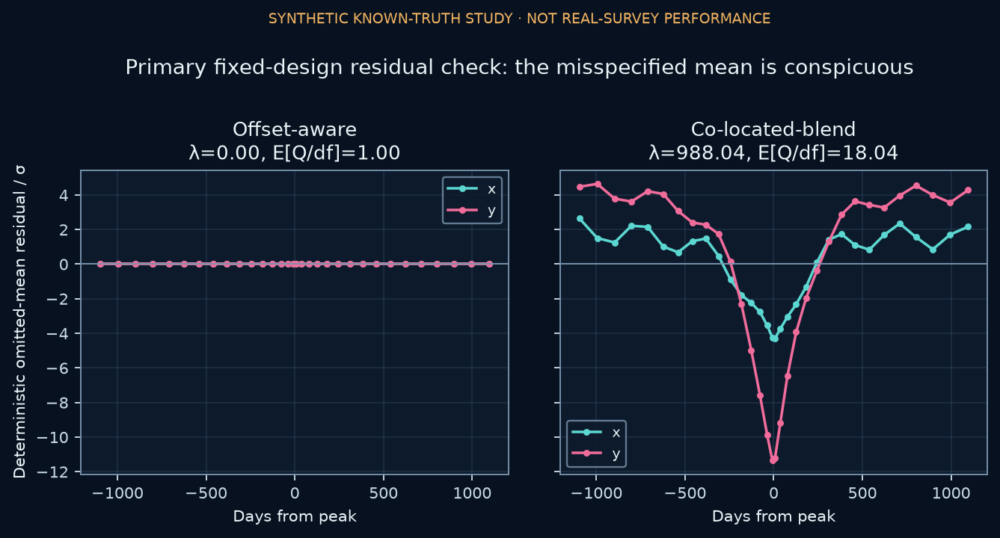

# Ghostlight

What happens when a gravitational-lensing model puts light from a second star in the wrong place?



In this simulation, the wrong model misses the true value more often while reporting almost the same error bars. The pattern left in the residuals makes the problem visible. No real observations were analyzed.

[Read the case study](https://alisonthomasportfolio.com/projects/ghostlight) · [Explore the code](study/src/ghostlight) · [Methods](study/METHODOLOGY.md)

## Run locally

With Python 3.12 and [uv](https://docs.astral.sh/uv/):

```sh
cd study
uv sync --frozen --extra dev
uv run pytest
uv run ghostlight verify
```

The saved figures and tables are in study/outputs. See [reproduction details](study/REPRODUCIBILITY.md) for the full simulation.
