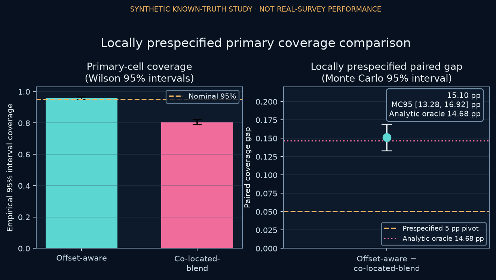
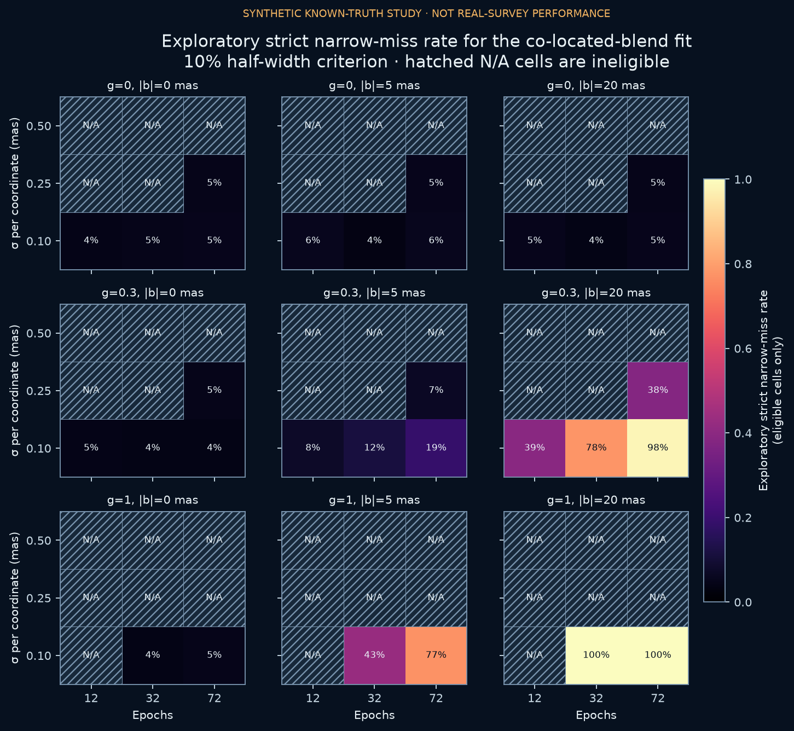
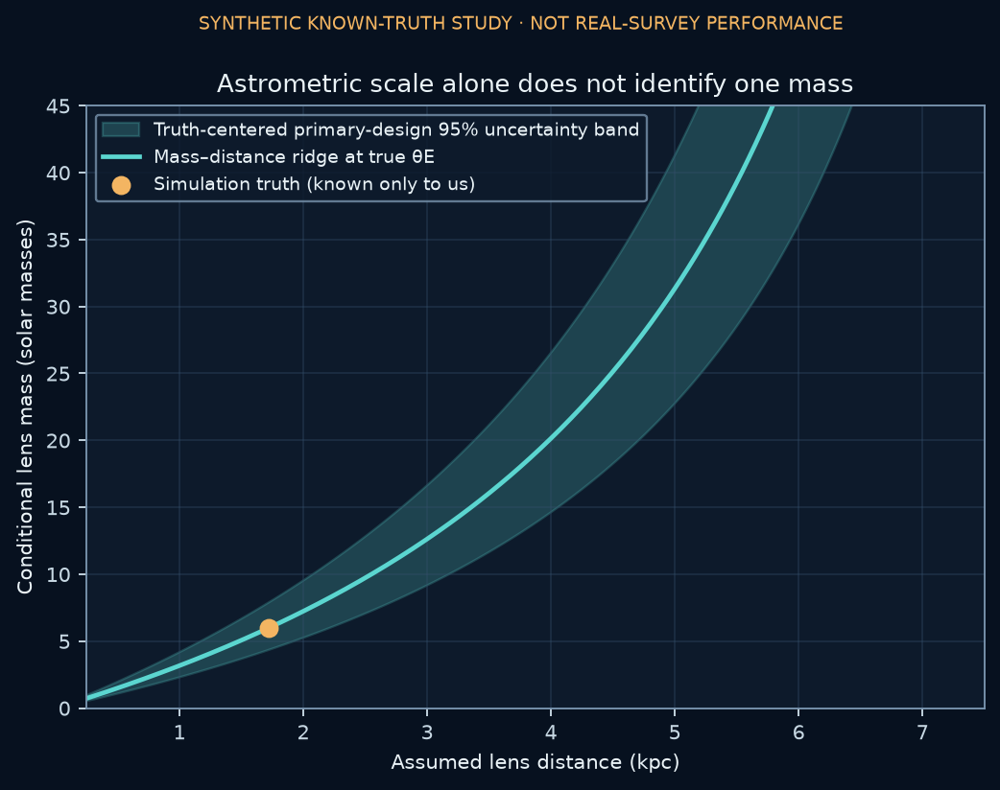

# Ghostlight

**A known-truth astrometric-microlensing study of model misspecification, interval
coverage, and model checking.**

Ghostlight began as a broader portfolio direction about what stellar motion can reveal
about an invisible lens. Under Alison Thomas's portfolio brief and constraints, Codex
selected a narrower question that could be tested with exact physics and known truth in a
same-session build: what happens to an angular-Einstein-radius interval when an unresolved
blend's flux is known but its position is modeled incorrectly? Codex generated the
implementation, tests, analysis, documentation, and draft public copy. Automated and
analytic checks passed for the stated synthetic model. Alison's human science, copy,
contribution, and release review is pending, and no independent peer review has been
performed.

## Question and frozen design

The simulator injects a static unresolved blend at a known offset and fits every synthetic
dataset twice:

- an **offset-aware model** that fits the two blend-offset components;
- a **co-located-blend model** that knows the blend flux but fixes its position to the source.

The fixed grid has 81 executed parameter-grid rows and 2,000 paired noise realizations per
row: 162,000 synthetic datasets, with both models evaluated on the same draws.
Those 81 rows contain 21 distinct true-mean vectors and 63 distinct mean-plus-noise
data-generating distributions. Within the 27 `g = 0` conditions, nine cadence/noise
distributions are distinct and 18 are deliberate negative-control repeats.

The grid, seed, interval definition, and run contract were frozen locally before the saved
stochastic result. One row and its paired coverage estimand were designated primary, and the
five-point interpretation rule was fixed, before the workflow inspected the computed
analytic oracle. The exact linear-Gaussian oracle was then evaluated before Monte Carlo. The
analytic structure and answer were available to the same AI-assisted workflow that chose the
design, so this sequencing reduces within-grid outcome selection but is not external
registration, independent confirmation, or evidence of an Alison-made technical choice.

> **Every result is synthetic.** The injected event is on the scale of OB110462, but this is
> not a reanalysis of OB110462 and does not estimate any real survey's performance.

## Original seeded evidence

In the locally prespecified primary design, the offset-aware model's 95% intervals covered
the injected Einstein radius in **95.8%** of paired trials; the co-located-blend model covered
it in **80.7%**. Its formal standard error was only **0.19% lower** (0.3611 rather than 0.3618
mas), yet the paired coverage loss was **15.10 percentage points** (Monte Carlo SE 0.928
points; Monte Carlo 95% interval 13.281–16.919 points). The exact analytic prediction was
14.680 points. The co-located fit's empirical bias was
`-0.398060 ± 0.007917 mas` Monte Carlo SE; closed-form omitted-variable algebra predicted
`-0.398294 mas`.

All 81 rows were generated by that one seeded full-grid command. “Exploratory” describes how
the other 80 rows are interpreted, not a second stochastic run after the primary result.



## A later deterministic audit changed the interpretation

On 2026-08-08, a later red-team pass asked a question the original candidate did not report:
would the wrong mean model survive an ordinary residual check? The answer was no. Using the
already-declared fixed design, deterministic projection gives the co-located fit residual
RMS `0.982283 mas`, `df = 58`, noncentrality `lambda = 988.036`, expected reduced
`Q = 18.035`, and effectively 100% power for a 5% chi-square lack-of-fit check. The
offset-aware fit has expected reduced `Q = 1.000`.

No new random draws were created for this audit or the schema-3 reporting update. Protected
primary counts, paired outcomes, and scenario summaries remained unchanged. Per-trial
residual vectors were not retained, so observed residual `Q`, observed-data p-values, and
empirical rejection rates remain unavailable rather than being reconstructed through a new
stochastic run.

The later audit changed what the seeded result means. The example does not show a wrong model
quietly surviving a complete analysis. It shows that a coefficient's formal covariance is
conditional on the assumed mean and is not itself a model check.


## Exact mechanism

For lens-to-source separation vector **u**, the dark-lens centroid shift is

```text
delta = theta_E u / (|u|^2 + 2).
```

If `g = F_blend / F_source`, `A` is the point-lens magnification, and **b** points from the
source to the blend, the observed centroid minus its same-time unlensed blended baseline is

```text
[A / (A + g)] delta + [g(1 - A) / ((A + g)(1 + g))] b.
```

This is direct flux weighting, not an additive approximation. During magnification, the
second coefficient is negative: extra source light pulls the apparent centroid away from its
blended baseline and back toward the source. Omitting that time-dependent offset term can
project into the fitted `theta_E` coefficient.

## Verification chain

The fit is deliberately conditional. It treats the photometric trajectory and blend ratio as
known, fits position, proper motion, annual source parallax, and `theta_E`, and uses
independent Gaussian errors with known per-coordinate standard deviation. It is not a full
microlensing posterior.

The evidence chain includes:

- paired draws so the primary coverage contrast retains within-realization information;
- exact omitted-variable bias and normal-theory coverage calculations;
- count-based Wilson intervals and explicit Monte Carlo standard errors;
- fixed-design rank, conditioning, and lack-of-fit calculations;
- a scalar-equation/QR reference path that does not call the production physics, stacking,
  design, or SVD solver functions; and
- deterministic metric recomputation plus SHA-256 artifact verification.

The simulation and oracle are separate checks with different failure modes. The later
scalar/QR path reduces shared-production-code risk, but it remains an AI-authored,
same-specification, same-environment internal self-check rather than external validation.

## Exploratory sensitivity from the same run

The remaining 80 rows form a constructed calibration-sensitivity surface, not a sampled
event population. After repeated `g = 0` controls are first aggregated within their shared
DGP, the unweighted macro-average across 63 distinct offset-aware DGPs is 95.07% (oracle-MCSE
normal 95% interval 94.95–95.18%). It is descriptive and has no heterogeneous pooled-binomial
Wilson interval.

A separate 0–360° analytic sweep shows that omitted-variable bias depends on blend direction.
It uses no additional Monte Carlo draws, and the fixed 67° direction is neither representative
nor optimized. In the later grid-wide adequacy audit, all 23 cells with at least a five-point
analytic coverage loss also had large residual noncentrality; the minimum was 245.162 and the
minimum expected reduced `Q` was 5.009. The wider surface therefore extends the sensitivity
map, not a hidden-failure claim.



## What the evidence does not claim

No real image, light curve, cadence, covariance product, or astrometric catalog enters the
pipeline. OB110462 supplies historical scale and motivation only. Its documented
bright-neighbor issue was a PSF-extraction positional bias, not the unresolved-centroid
mechanism isolated here, and Ghostlight's round 6-solar-mass truth is not a current mass
estimate.

The conditional fit estimates `theta_E`; it does not identify relative parallax. The
mass–distance figure is therefore an explanatory nonclaim: without independent relative
parallax, `theta_E` defines a ridge of compatible masses and distances rather than one fitted
black-hole mass. Its shading is a truth-centered design illustration, not a realized interval
or posterior.



## Verify the saved candidate

Requirements: Python 3.11 or newer and [uv](https://docs.astral.sh/uv/).

```bash
export MPLCONFIGDIR="$PWD/.mplconfig"
export UV_NO_EDITABLE=1
uv sync --frozen --extra dev --python 3.12
.venv/bin/pytest
.venv/bin/ghostlight verify --project-root . --recompute
```

This path checks the saved evidence without executing `ghostlight run`. Full regeneration is
documented separately in [REPRODUCIBILITY.md](REPRODUCIBILITY.md); it is not evidence that a
second experiment occurred during the later remediation.

## Start here

1. [Results](outputs/RESULTS.md) — the original seeded result, later adequacy audit, and claim
   boundary.
2. [Manuscript](MANUSCRIPT.md) — the article-length methods, results, discussion, and
   references.
3. [Reproducibility guide](REPRODUCIBILITY.md) — saved-evidence verification, full
   regeneration, environment limits, and release status.

Supporting detail lives in [METHODOLOGY.md](METHODOLOGY.md),
[DATA_CONTRACT.md](DATA_CONTRACT.md), and [MODEL_CARD.md](MODEL_CARD.md). The
[decision log](DECISIONS.md), [AI disclosure](AI_ASSISTANCE.md), and canonical
[review status](REVIEW_STATUS.md) preserve the process and ownership boundaries. The current
candidate remains unindexed and unpromoted while Alison's review is pending.

## Project map

```text
src/ghostlight/                 Physics, inference, simulation, reporting, CLI
tests/                          Analytic, statistical, deterministic, and safety checks
data/source_manifest.json       Literature provenance and source roles
data/canonical_parity_fixture.json  Canonical Python vectors for equation parity
REVIEW_STATUS.md                Canonical release and human-review status
outputs/metrics.json            Machine-readable design, results, and audit fields
outputs/tables/                 Atlas, trial, residual, scenario, and ridge tables
outputs/figures/                Eight generated scientific figures
outputs/artifact_manifest.json  SHA-256 fingerprints for generated artifacts
```
